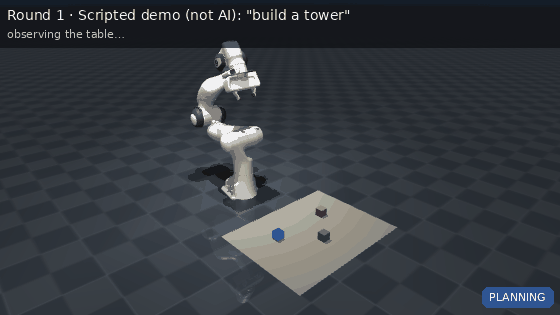

# OpenRobot-Brain

**GPT-6 Astra looks at a table through a camera, plans pick-and-place for a Franka Panda, and local code checks every motion before the robot moves.**



<sub>Demo above: the offline scripted planner (no AI), recorded with `--record`. With an API key, GPT-6 Astra plans from the camera image instead.</sub>

## What it does

You type a task like *"stack the red cube on the blue cube"*. Each round:

1. **See.** The arm parks out of view and an overhead camera takes a picture.
2. **Think.** GPT-6 Astra gets the image and returns where each object is (pixel coordinates), what it decides, and up to 6 high-level actions (`pick`, `place_on`, `place_at`, `move_to`, `go_home`, `wait`). It can also answer `done` or `infeasible`.
3. **Ground.** The robot converts those pixels into metres with a calibrated camera model. The model never invents raw coordinates.
4. **Check.** Actions are expanded into the exact joint trajectory the arm would follow, and every sample is checked: inverse kinematics, joint limits and speeds, workspace, transit height, and collisions with the table and other objects. One violation rejects the whole round and nothing moves.
5. **Act.** MuJoCo plays the validated trajectory on a physically simulated Panda.
6. **Learn.** What happened (grasp succeeded, gripper closed on nothing, plan rejected and why) goes back to the model with a fresh image, and it tries again, up to a capped number of rounds.

```
camera ─▶ GPT-6 Astra ─▶ pixels → metres ─▶ skills → joint trajectory ─▶ safety checks ─▶ MuJoCo
   ▲            (untrusted)                                              │ reject: nothing moves
   └──────────────── outcome + new image ◀───────────────────────────────┘
```

**The model proposes; local code decides.** Model output is treated as untrusted input at every step.

## Honest scope

- Simulation only (MuJoCo). There is no code path to real hardware.
- Objects are 4 cm cubes; the gripper always points straight down.
- GPT-6 Astra is the only AI planner. The `--offline` planner is a short script for demos and tests, and it is labelled as such everywhere.
- **First live result (one run, not a benchmark):** GPT-6 Astra (`effort=low`) located all three visible cubes from the overhead image to within **0.0–0.2 cm** of ground truth and completed "stack the red cube on the blue cube" in 3 rounds (one round was an invalid response, rejected and fed back). The partly hidden base cube was estimated within 1.9 cm. Every run prints these errors, so you can check them yourself.
- The vision pipeline is also tested offline with a stand-in "model" that finds colour blobs in the rendered image.

## Install (Windows PowerShell)

Requires Python 3.11+.

```powershell
git clone https://github.com/Arjunros/openrobot-brain.git
cd openrobot-brain
py -3.11 -m venv .venv
.\.venv\Scripts\Activate.ps1
python -m pip install --upgrade pip
pip install -e ".[dev,video]"
```

If activation is blocked, run `Set-ExecutionPolicy -Scope CurrentUser RemoteSigned` once. Your prompt must show `(.venv)` before you use `pip` or `orb`.

API key (only needed for GPT-6 Astra):

```powershell
Copy-Item .env.example .env
notepad .env          # OPENAI_API_KEY=sk-...   (never screenshot this file)
```

## Run

```powershell
orb sim-check                                                     # headless physics smoke test
orb demos                                                         # list offline demo tasks

# No API key needed (scripted, not AI)
orb run "build a tower" --offline --execute
orb run "unsafe demo" --offline --execute                         # rejected every round, nothing moves

# GPT-6 Astra with vision
orb run "stack the red cube on the blue cube"                     # plan + validate round 1 only (dry run)
orb run "stack the red cube on the blue cube" --execute           # closed loop in the MuJoCo viewer
orb run "build a tower with blue at the bottom" --execute --seed 7 # random cube layout
orb run "pick up the purple cube" --execute                       # expect: NOT FEASIBLE
orb run "stack red on blue" --no-vision --execute                 # model gets positions instead of an image

# Recording and presentation
orb run "build a tower" --execute --hold --speed 0.5              # keep the window open, slow motion
orb run "build a tower" --execute --headless --record tower.mp4   # captioned video, no screen recording
orb run "build a tower" --execute --save-images rounds            # save what the model saw each round
orb snapshot --seed 7                                             # save overhead + front camera images
```

| Flag | Meaning |
|---|---|
| `--execute` | run in MuJoCo. Without it, round 1 is planned and validated only. |
| `--headless` | no window |
| `--hold` | keep the viewer open after the run |
| `--speed 0.5` | viewer and video playback speed |
| `--record x.mp4` / `x.gif` | captioned video from the simulator (`.mp4` needs the `video` extra) |
| `--no-vision` | send object positions as text instead of an image |
| `--effort low…max` | Astra reasoning effort (default `low`) |
| `--rounds N` | round limit (cap 8) |
| `--seed N` | random cube layout |
| `--offline` | scripted demo planner, no API |

Exit codes: `0` done or dry run, `2` rejected by safety, `3` planner/API error, `4` simulation error, `5` not completed (infeasible or round limit).

## Test

```powershell
pytest                                                             # ~120 tests, no API key, ~1 min
$env:ORB_LIVE_OPENAI_KEY = "sk-..."; pytest -m live -s             # optional: one live Astra vision run
```

The suite runs real physics (grasps, stacking, missed grasps), real rendering, and the full closed loop: a stand-in vision model misreads a cube by 60 px, the grasp misses, the failure is fed back, and the next round succeeds. The OpenAI client is never called in unit tests.

## Layout

```
src/openrobot_brain/
  agent.py        closed loop: observe → plan → ground → validate → execute → feed back
  planner.py      GPT-6 Astra (Responses API, image input, strict JSON) + offline script
  schema.py       strict round schema: status, message, observations, actions
  perception.py   model pixels → metres; perception error vs ground truth
  skills.py       pick / place_on / place_at / move_to / go_home / wait → joint trajectories
  safety.py       independent trajectory validator → ValidatedPlan
  world.py        world belief (objects, stacks, held object)
  config.py       joint limits, workspace, speeds, safety limits
  simulation/
    executor.py   PandaSim: reset, camera, execute, grasp detection, viewer
    kinematics.py IK (damped least squares), FK, collision queries on a scratch copy
    camera.py     pinhole camera model (world ↔ pixel)
    recorder.py   captioned MP4/GIF rendering
    franka_emika_panda/   Menagerie Panda (Apache-2.0) + tabletop scene
docs/architecture.md, docs/safety.md
```

## Credits and license

Apache-2.0, see [LICENSE](LICENSE) and [NOTICE](NOTICE). Franka Emika Panda model from [MuJoCo Menagerie](https://github.com/google-deepmind/mujoco_menagerie) (Apache-2.0), with one added TCP site.
